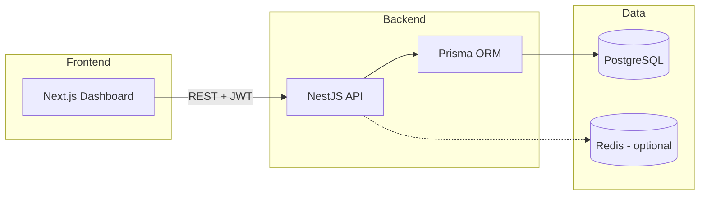

# Room Management System

[](https://github.com/gennaro-16/room-management-system/actions/workflows/ci.yml)
[](./LICENSE)
[](https://nestjs.com/)
[](https://nextjs.org/)
[](https://www.postgresql.org/)

A production-style **meeting room booking platform** with real-time room status, conflict detection, role-based access, visitor tracking, and an admin approval workflow.

Built as a full-stack portfolio project: **NestJS + Prisma + PostgreSQL** API and **Next.js 14 + TypeScript + Tailwind** dashboard.

> **Branding:** This public release uses a neutral identity ("Room Booking System"). The original client-branded version is archived on [`branded-client-version`](https://github.com/gennaro-16/room-management-system/tree/branded-client-version). See [BRANDING.md](./BRANDING.md).

---

## Live demo & portfolio

| Resource | Link |
|----------|------|
| Portfolio presentation | _Add your portfolio URL here_ |
| API (local) | http://localhost:3000 |
| Swagger docs (local) | http://localhost:3000/api |
| Dashboard (local) | http://localhost:3001 |

---

## Features

| Area | What it does |
|------|----------------|
| **Rooms** | CRUD, capacity, floor, amenities, live status (free / busy / maintenance / reserved) |
| **Bookings** | Request slots with automatic overlap prevention |
| **Conflicts** | Detect clashes and suggest alternative rooms or nearby time slots |
| **Roles** | Admin, employee, guest — with user & booking approval flows |
| **Departments** | Organize users and rooms by department and floor |
| **Visitors** | Track external visitors and link visits to bookings |
| **Dashboard** | Stats, today's bookings, room status overview, calendar timeline |
| **Notifications** | In-app alerts for booking and approval events |

---

## Architecture



---

## Quick start (Docker)

The fastest way to run everything:

```bash
git clone https://github.com/gennaro-16/room-management-system.git
cd room-management-system

cp .env.example .env
# Edit .env — set POSTGRES_PASSWORD and JWT_SECRET to real values

docker compose up --build
```

| Service | URL |
|---------|-----|
| Frontend | http://localhost:3001 |
| Backend API | http://localhost:3000 |
| Swagger | http://localhost:3000/api |
| PostgreSQL | localhost:5432 |

Seed the database (first time):

```bash
docker compose exec backend npx prisma migrate deploy
docker compose exec backend npx prisma db seed
```

---

## Quick start (local development)

### 1. Database

Start PostgreSQL (or use Docker for DB only):

```bash
docker compose up -d db redis
```

### 2. Backend

```bash
cd room-management-backend-nest
cp env.example .env
# Set DATABASE_URL and JWT_SECRET in .env

npm install
npx prisma migrate dev
npx prisma db seed    # optional sample data
npm run start:dev     # → http://localhost:3000
```

### 3. Frontend

In a second terminal:

```bash
cd room-management-frontend-next
cp env.example .env.local
# NEXT_PUBLIC_API_URL=http://localhost:3000

npm install
npm run dev           # → http://localhost:3001
```

### One-command helper

From the repo root:

```bash
./start-project.sh
```

---

## Demo login

After seeding:

| Role | Email | Password |
|------|-------|----------|
| Admin | `admin@bank.com` | `password123` |

Fictional seed data only — never use these in production.

---

## Project structure

```
room-management-system/
├── room-management-backend-nest/   # NestJS API, Prisma schema, migrations
├── room-management-frontend-next/  # Next.js dashboard (App Router)
├── scripts/                        # deploy.sh, dev.sh
├── docker-compose.yml              # Dev: db + backend + frontend + redis
├── docker-compose.prod.yml         # Prod: + nginx reverse proxy
├── .env.example                    # Root env template (Docker)
├── BRANDING.md                     # Rebrand notes + archived branch
├── CONTRIBUTING.md                 # How to contribute
└── SECURITY.md                     # Reporting issues & secret handling
```

---

## Environment variables

Copy [`.env.example`](./.env.example) and fill in:

| Variable | Required | Description |
|----------|----------|-------------|
| `DATABASE_URL` | Yes | PostgreSQL connection string (backend) |
| `JWT_SECRET` | Yes | Long random string for signing JWTs |
| `JWT_EXPIRES_IN` | No | Token lifetime (default `24h`) |
| `FRONTEND_URL` | Yes | CORS origin (e.g. `http://localhost:3001`) |
| `NEXT_PUBLIC_API_URL` | Yes | API base URL for the frontend |
| `POSTGRES_PASSWORD` | Docker | Database password for compose |

Never commit `.env` files — they are gitignored.

---

## Scripts

| Command | Where | Purpose |
|---------|-------|---------|
| `npm run start:dev` | backend | Hot-reload API |
| `npm run dev` | frontend | Hot-reload dashboard |
| `npm test` | backend | Unit tests |
| `npm run lint` | both | ESLint |
| `npm run build` | both | Production build |
| `./scripts/dev.sh` | root | Start DB + migrate + seed |
| `./scripts/deploy.sh` | root | Docker production deploy |

---

## Documentation

| Doc | Contents |
|-----|----------|
| [Comprehensive docs](./COMPREHENSIVE_DOCUMENTATION.md) | Full system overview |
| [Technical docs](./TECHNICAL_DOCUMENTATION.md) | Architecture deep-dive |
| [API docs](./API_DOCUMENTATION.md) | Endpoint reference |
| [User guide](./USER_GUIDE.md) | End-user manual |
| [Docker deployment](./DOCKER_DEPLOYMENT.md) | Production deployment |
| [Branding](./BRANDING.md) | Open-source rebrand + archived branch |
| [Contributing](./CONTRIBUTING.md) | Dev workflow for contributors |
| [Security](./SECURITY.md) | Vulnerability reporting |

---

## Troubleshooting

**Frontend can't reach API**
- Check `NEXT_PUBLIC_API_URL` in `.env.local`
- Ensure backend is running on port 3000
- Verify `FRONTEND_URL` in backend `.env` matches your frontend origin

**Database connection failed**
- Confirm PostgreSQL is running (`docker compose ps`)
- Match `DATABASE_URL` credentials with `POSTGRES_*` in `.env`

**Prisma migrate errors**
- Run from `room-management-backend-nest/`
- Try `npx prisma migrate reset` (⚠️ wipes data) then `npx prisma db seed`

**Port already in use**
- Backend: 3000 · Frontend: 3001 · Postgres: 5432
- Stop conflicting processes or change ports in `.env`

---

## License

[MIT](./LICENSE) — free to use, modify, and share with attribution.
